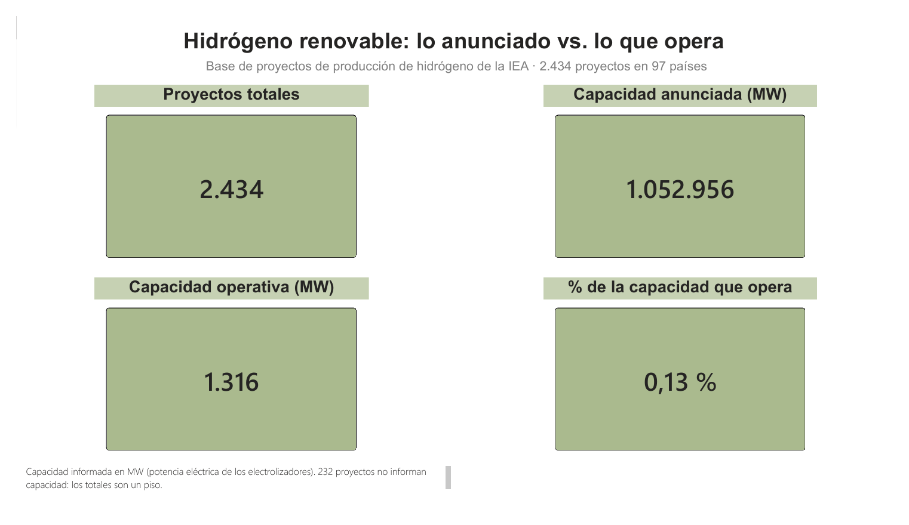
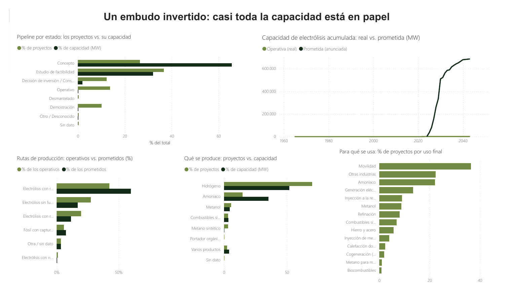
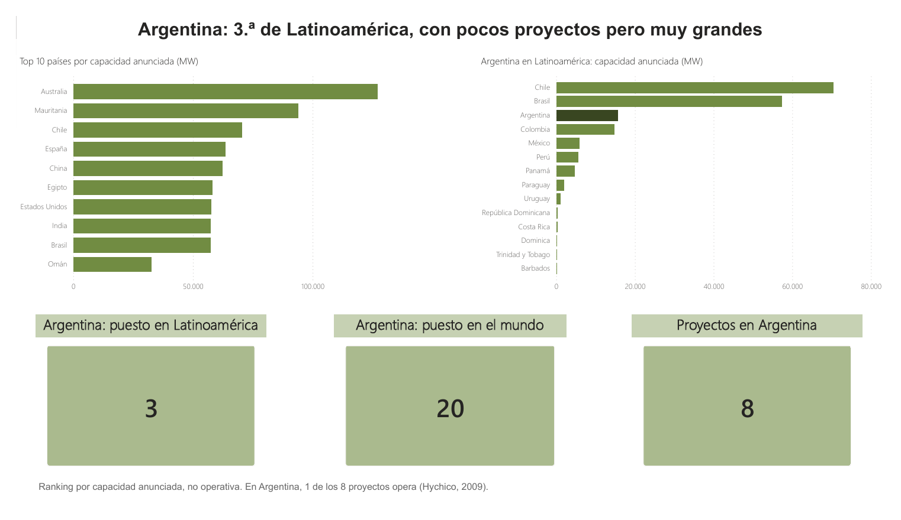
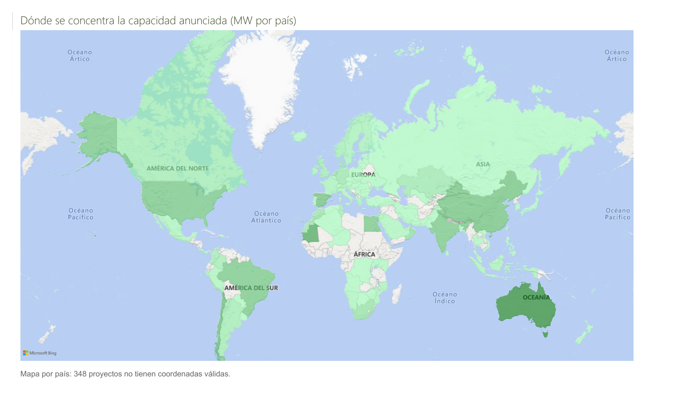
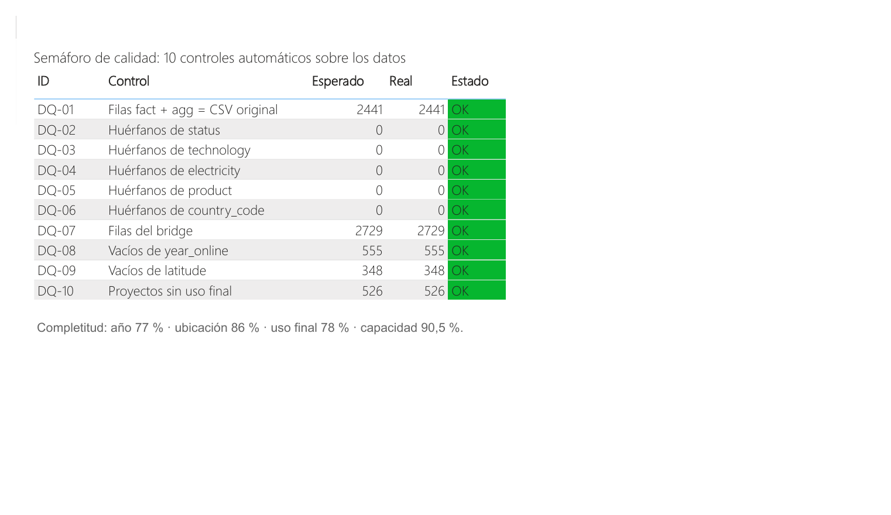

# Renewable Hydrogen: Announced vs. Operating

**An end-to-end data analysis project on the IEA Hydrogen Production Projects Database: Power Query → Python → PostgreSQL → Power BI.**

Projects registered by the IEA add up to **1,052,956 MW** of announced electrolysis capacity, but only **1,316 MW** are in operation: **0.13%**. This repository shows how that number was built and why it can be trusted.



---

## Objective

Take a real, public and messy dataset and turn it into reliable, documented and reproducible information. Hydrogen is the use case; the method is the point.

The work follows four principles:

- **Traceability:** every transformation is documented and justified.
- **Reproducibility:** with a new version of the source file, the whole pipeline refreshes without redoing the work.
- **Visible data quality:** what is missing or inconsistent is measured and shown, not hidden.
- **Caution:** the data says *what* happens; explanations are presented as hypotheses.

## Data source

- **Dataset:** [IEA Hydrogen Production Projects Database](https://www.iea.org/data-and-statistics/data-product/hydrogen-production-and-infrastructure-projects-database) (International Energy Agency), obtained through Kaggle, unmodified.
- **Size:** 2,441 rows × 37 columns, in a single CSV file (`datos/projects.csv`).
- **Content:** country, project status, commissioning year, technology, electricity source, product, 14 end uses, IEA-normalized capacities and coordinates.
- **Main measure:** capacity in **MWel**, the electrical power consumed by the electrolysers. It measures plant size, not energy produced.

> Source: IEA, Hydrogen Production and Infrastructure Projects Database, IEA, Paris. Licence: CC BY 4.0. Obtained via Kaggle. The original file is included unmodified; all cleaning and transformations are this project's own work and are not endorsed by the IEA.

## Pipeline

```
projects.csv ──► Power Query (Excel) ──► Python ──► PostgreSQL ──► Power BI
   raw data       cleaning + model      CSV export   DB + analysis   dashboard
```

| Stage | Tool | What it does |
|---|---|---|
| 1. Cleaning and modeling | Power Query (Excel) | 27 queries in 6 layers apply 18 documented cleaning rules and build a star schema |
| 2. Export | Python (pandas) | Exports the 10 final tables to neutral CSV files |
| 3. Database and analysis | PostgreSQL 18 | Loads the tables with keys and constraints, runs quality checks, answers 8 analysis questions and exposes 10 views |
| 4. Visualization | Power BI | A 5-page dashboard connected to the views; it recalculates nothing on its own |

### 1. Power Query (Excel)

- The original file is **never modified**: every cleaning step is recorded and replays on refresh.
- The file path is a **parameter** (`pRutaCSV`): point it to a new version of the data and refresh everything.
- **Flag instead of delete:** doubtful records (possible duplicates, invalid locations, missing capacity) get a true/false flag so they can be counted, filtered and shown.
- **Visible rules:** category corrections live in editable mapping tables (`Config_mapeos.xlsx`, `Config_paises.xlsx`), not hidden in code.
- **Result:** a star schema with `fact_projects` (2,434 projects), 6 dimensions (status, technology, electricity, product, country, end use), a bridge table for the many-to-many end uses, and `agg_confidential` for the 7 aggregated rows.
- **Data quality tables:** column completeness, a log of the 18 cleaning rules with live counts, and a data dictionary covering 80 columns.

### 2. Python

`scripts/01_exportar_tablas.py` reads the final tables from the Excel workbook and writes them as UTF-8 CSV files to `datos/export_postgres/`.

### 3. PostgreSQL

Three schemas: `model` (star schema), `dq` (data quality) and `analytics` (views for the dashboard).

| Script | Content |
|---|---|
| `sql/01_crear_esquemas.sql` | Creates the 3 schemas |
| `sql/02_crear_tablas.sql` | 10 tables with data types, primary keys, foreign keys and CHECK constraints |
| `sql/03_cargar_datos.sql` | Loads the 10 CSV files with `COPY`, each with a row-count check, plus a closing reconciliation |
| `sql/04_controles_calidad.sql` | Orphan checks (anti-joins), completeness, and a 10-check quality traffic light |
| `sql/05_consultas_analiticas.sql` | The 8 analysis questions, each with its control and commented result |
| `sql/06_vistas_analiticas.sql` | 10 views in `analytics` consumed by Power BI |

SQL techniques used: CTEs, window functions (`SUM() OVER ()`, running totals, `RANK()` with `PARTITION BY`), `FILTER`, `CASE WHEN`, anti-joins, `UNION ALL` and scalar subqueries.

### 4. Power BI

Connected in Import mode to the `analytics` views. Formatted KPI cards use DAX measures, for example:

```DAX
Pct Capacidad Opera =
FORMAT(
    DIVIDE( SUM('P1 Panorama'[mwel_operativo]), SUM('P1 Panorama'[mwel_total]) ) * 100,
    "0.00", "es-AR"
) & " %"
```

The percentage is computed from the same two figures shown next to it, so the cards always reconcile.

## Data quality

Every number in the dashboard is checked against a known total. All 10 automated checks pass, and they recalculate on every refresh.

| Check | Expected | Result |
|---|---|---|
| Projects + aggregated rows = original file | 2,441 | 2,434 + 7 = 2,441 |
| Capacity before and after splitting tables | 1,070,672.71 MW | Matches to the decimal |
| Orphan values (status, technology, electricity, product, country) | 0 | 0 in all 5 |
| Project–end use pairs | 2,729 | 2,729 |
| Measured gaps: year, location, end use | 555 · 348 · 526 | Match |

The checks also catch silent errors: a typo in one query (`'Cocept'` instead of `'Concept'`) raised no error, but the total dropped from 1,832 to 1,188 projects. The control caught it before it reached the dashboard.

**Completeness:** commissioning year 77% · location 86% · end use 78% · capacity 90.5%.

### Main issues found in the raw data

| Issue | Size | Action |
|---|---|---|
| Decimals broken by regional settings (a latitude of 51.7 read as 517 trillion) | Whole file | Always import the original CSV with US culture |
| Rows that are confidential totals, not projects | 7 rows, 17,717 MW | Moved to a separate table, kept |
| Inconsistent status categories (typos, synonyms) | 20 values | Editable mapping tables |
| Fake (0,0) coordinates | 348 projects | Converted to null and flagged |
| Missing commissioning year | 555 projects (23%) | Measured and shown; 9 in 10 are early-stage |
| No capacity reported | 232 projects | Flagged; totals are a floor |
| Possible duplicates (same name and country) | 41 rows | Flagged, not deleted; max impact < 1% |

## Key findings

**What the data shows**

- **Announced vs. operating:** 1,052,956 MW announced, 1,316 MW operating (0.13%).
- **An inverted funnel:** 97.7% of capacity is at concept or feasibility stage; only 1.9% has a final investment decision or is under construction.
- **The announced leap:** the industry has built 1,316 MW in its whole history; 176,797 MW are announced for 2030 alone.
- **Cleaner on paper:** dedicated-renewable electrolysis goes from 42.5% of operating projects to 60% of announced ones.
- **Capacity is not project count:** Mauritania, with 10 projects, ranks 2nd worldwide, ahead of the United States with 190. The top 10 countries hold 64.6% of capacity.
- **Argentina:** 3rd in Latin America and 20th worldwide, with 15,740 MW across 8 projects. Only one is operating (Hychico, Comodoro Rivadavia, since 2009).

**Hypotheses (not confirmed by the data)**

- Ammonia projects are 14.7% of projects but 35.4% of capacity (≈ 1,041 MW average vs. ≈ 321 MW for pure hydrogen), which suggests export-oriented megaprojects.

## Dashboard

| | |
|---|---|
| **1. Overview** — the four headline numbers | **2. Pipeline and production** — status funnel, real vs. announced, routes, products, end uses |
|  |  |
| **3. Countries and Argentina** — global ranking and Latin America | **4. World map** — where announced capacity concentrates |
|  |  |
| **5. Data quality** — 10-check traffic light and completeness | |
|  | |

The full dashboard is available as a PDF in `PDF/H2_Dashboard.pdf` and as a Power BI file in `powerbi/H2_Dashboard.pbix`. The dashboard labels are in Spanish.

## Limitations

- **Reported capacity:** 232 projects report no capacity and 41 operating projects have no MWel, so totals are a floor.
- **Future years are intentions:** an announced commissioning year is not a commitment.
- **Database cut-off around 2024:** the IEA updates dates between editions; measuring delays requires comparing editions.
- **End uses:** a project can declare several uses, so projects are counted (not capacity) and percentages add up to more than 100%.
- **Location:** 348 projects have no valid coordinates, so the map is drawn by country.

## Repository structure

```
H2_Proyecto_Dashboard/
├── README.md
├── datos/
│   ├── projects.csv                 # original IEA file (untouched)
│   ├── H2_Fase1_PowerQuery.xlsx     # Power Query workbook: 27 queries, model and data quality
│   ├── Config_mapeos.xlsx           # category mapping tables
│   ├── Config_paises.xlsx           # country, region and Latin America reference table
│   └── export_postgres/             # 10 CSV files exported by Python
├── scripts/
│   └── 01_exportar_tablas.py
├── sql/
│   ├── 01_crear_esquemas.sql
│   ├── 02_crear_tablas.sql
│   ├── 03_cargar_datos.sql
│   ├── 04_controles_calidad.sql
│   ├── 05_consultas_analiticas.sql
│   └── 06_vistas_analiticas.sql
├── powerbi/
│   └── H2_Dashboard.pbix
├── PDF/
│   ├── H2_Dashboard.pdf
│   └── Informe_H2_Martin_Luciano.pdf  # methodology report (Spanish)
└── images/                            # dashboard screenshots for this README
```

## How to reproduce

**Requirements:** Excel with Power Query, Python 3 with `pandas` and `openpyxl`, PostgreSQL (built with version 18) and Power BI Desktop (Windows).

1. **Power Query:** open `datos/H2_Fase1_PowerQuery.xlsx`, set the `pRutaCSV` parameter to the path of `datos/projects.csv`, and run **Data → Refresh All**. Check that the `chk_` control queries return `TRUE`.
2. **Python:** run `python scripts/01_exportar_tablas.py` to generate the 10 CSV files in `datos/export_postgres/`.
3. **PostgreSQL:** create a database named `h2_iea`, copy the CSV files to a path the PostgreSQL service can read (the scripts use `C:/H2/`; edit the paths in `03_cargar_datos.sql` if needed) and run the scripts `01` to `06` in order. The quality traffic light in `04` should return 10 rows in `OK`.
4. **Power BI:** open `powerbi/H2_Dashboard.pbix`, update the data source to your server and port (built on `localhost:5433`) and refresh.

## Author

**Martín Luciano** · Data Analyst · Santa Fe, Argentina
Google Data Analytics and IBM Data Analyst certificates.

- Email: [martinluciano213@gmail.com](mailto:martinluciano213@gmail.com)
- LinkedIn: [linkedin.com/in/martin-luciano-datos](https://www.linkedin.com/in/martin-luciano-datos)
